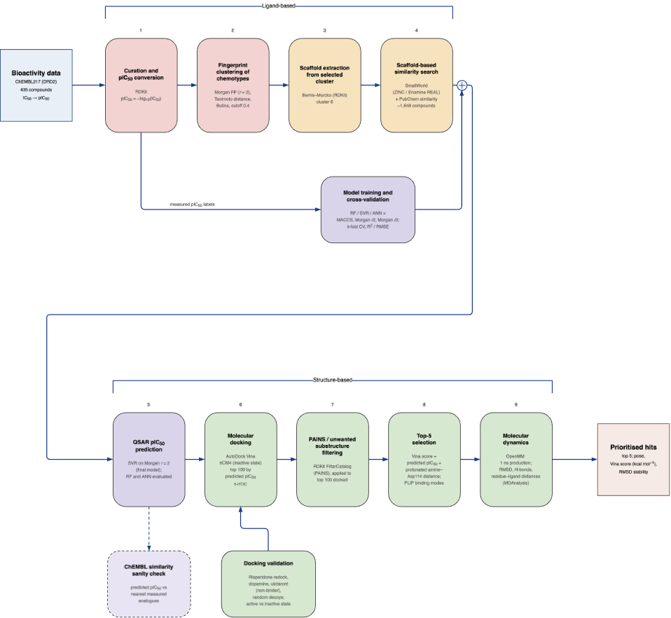

# Scaffold-guided in silico identification of dopamine D2 antagonists: potency prediction, docking, and an exploratory 5-HT2C counter-screen

**Group 6** — Manu Pancras, Bart Rabelink, Yunzhou Dong

Advanced Computational Methods in Drug Discovery (ACMDD), 2026–2027

This page is the cover sheet for the mini-research code. The workflow is kept in
separate numbered notebooks in this folder; this file states the title, the group,
the schematic workflow, and the global setup information that applies to all of
them. Start here, then run the notebooks in numerical order.

---

## Workflow

The pipeline runs in two halves. The **ligand-based** half (top) starts from the
DRD2 bioactivity data in ChEMBL: IC50 measurements are curated and
converted to pIC50 (1), the resulting 435 compounds are clustered by
fingerprint similarity to expose the chemotypes present in the data (2), and the
Bemis–Murcko scaffolds of the selected cluster are extracted (3) and used as the
query for a scaffold-based similarity search of commercial chemical space (4).
In parallel, the same curated pIC50 labels train and cross-validate the
regression models, from which a single final model is selected.

The two branches meet at the **structure-based** half (bottom). The final QSAR
model predicts pIC50 for every compound retrieved by the similarity
search (5), the best-predicted compounds are docked into the inactive-state DRD2
structure 6CM4 and counter-screened against 5-HT2C (6), and the docked shortlist
is filtered for PAINS and unwanted substructures (7). Surviving compounds are
ranked on docking score, predicted potency and binding-mode criteria to give the
top five (8), whose poses are then tested for stability by molecular dynamics (9),
yielding the prioritised hits. Two side branches feed back into the main line: a
ChEMBL similarity sanity check that compares predicted pIC50 against
the nearest measured analogues, and a docking-validation run of reference ligands
(risperidone redock, dopamine, ulotaront, decoys) that calibrates what a given
Vina score is worth.

---

## Global Setup and Project Information

### Databases used

| Database | URL | Accessed | Used for |
| --- | --- | --- | --- |
| ChEMBL REST API (target `CHEMBL217`, UniProt `P14416`) | <https://www.ebi.ac.uk/chembl/api/data> | *(fill in release + date)* | DRD2 IC50 bioactivities and 2D structures |
| ZINC22 / SmallWorld similarity search | <https://cartblanche22.docking.org> | *(fill in date)* | 1,648-compound scaffold-similarity library |
| ZINC22 random selection | <https://cartblanche22.docking.org> | *(fill in date)* | 10,000-compound random background library |
| RCSB PDB — `6CM4` (DRD2, inactive, risperidone-bound) | <https://www.rcsb.org/structure/6CM4> | *(fill in date)* | Docking receptor and docking-box reference ligand |
| RCSB PDB — `6BQH` (5-HT2C) | <https://www.rcsb.org/structure/6BQH> | *(fill in date)* | Off-target counter-screen receptor |

> The ChEMBL release number and the retrieval dates of the ZINC22 and PDB files
> were not recorded at the time of download; see
> [`../docs/reproducibility.md`](../docs/reproducibility.md). Fill the table in
> before submission, and record the release and access date whenever these
> datasets are retrieved again. A Git commit date is not a retrieval date.

### Software and packages

Two environments are used. The core analysis notebooks (01–05, 07) run under the
pinned [`../requirements.txt`](../requirements.txt):

| Package | Version | Package | Version |
| --- | --- | --- | --- |
| Python | 3.12 | Matplotlib | 3.11.1 |
| RDKit | 2026.3.6 | SciPy | 1.18.1 |
| scikit-learn | 1.9.1 | joblib | 1.6.0 |
| pandas | 3.0.6 | tqdm | 4.70.0 |
| NumPy | 2.5.3 | requests | 2.34.2 |

The docking notebooks (06, 08) additionally require the Conda environment
documented in [`../docking/README.md`](../docking/README.md):

| Package | Version | Package | Version |
| --- | --- | --- | --- |
| Python | 3.12.15 | Biopython | 1.88 |
| AutoDock Vina | 1.2.7 | PDBFixer | 1.12 |
| Meeko | 0.8.0 | OpenMM | 8.6.1 |
| RDKit | 2026.03.1 | | |

### Global settings and parameters

| Parameter | Value | Where it applies |
| --- | --- | --- |
| `TARGET_UNIPROT_ID` / target | `P14416` / `CHEMBL217` | ChEMBL query (01) |
| Activity filter | `type=IC50`, `relation="="`, `assay_type="B"`, units nM | ChEMBL query (01) |
| pIC50 conversion | pIC50 = 9 − log10(IC50 [nM]) | Curation (01) |
| Duplicate handling | one record per `molecule_chembl_id`, first kept | Curation (01) |
| `MAX_PATH` | 5 | RDKit topological fingerprint (02) |
| `CLUSTERING_CUTOFF` | 0.4 Tanimoto distance | Butina clustering (02) — justified by the cutoff scan |
| Selected cluster | index 6 of the size-sorted list | Scaffold analysis (03) |
| Fingerprints | MACCS (166 bits), Morgan r=2 and r=3 (2048 bits) | Model benchmark (04) |
| Models benchmarked | RandomForest, SVR, MLP (ANN) | Model benchmark (04) |
| `N_FOLDS` | 5 | Cross-validation (04) |
| Final model | SVR on Morgan r=2 — highest CV R², lowest RMSE | Prediction (05) |
| Applicability domain | max Morgan-r2 Tanimoto similarity to the training set | Prediction (05) |
| `BOX_PADDING_ANGSTROM` | 8.0 | Docking box around the native ligand (06, 08) |
| Docking receptor | local `6CM4_Na` mmCIF, chain residues 35–222 and 364–442, Na+ retained | Docking (06) |
| Counter-screen receptor | `6BQH`, box defined by native ligand `E2J` | Docking (08) |

Unless stated otherwise, defaults were used — including AutoDock Vina's default
exhaustiveness and number of modes. Every notebook resolves the repository root
from the kernel's working directory, so paths work whether Jupyter is started in
the repository root or in `src/`.

### Required input files

| File | Purpose |
| --- | --- |
| `data/raw/drd2_curated_compounds.csv` | 435 curated DRD2 compounds (pIC50 + SMILES); training data |
| `data/raw/scaffold_zinc22.csv` | 1,648 scaffold-similarity compounds to be screened |
| `data/raw/random_zinc22.csv` | 10,000 random compounds — background library |
| `data/raw/comparison_smiles` | Reference ligands for docking validation |
| `data/raw/5ht2c_docking_ligands.csv` | Top-5 hits + Ritanserin/Risperidone for the counter-screen |
| `data/raw/crystal_structures/6cm4.mmcif` | Source of the risperidone (`8NU`) coordinates defining the docking box |
| `data/processed/crystal_structures/6CM4_Na.mmcif` | Prepared DRD2 receptor used for docking |
| `models/final_svr_morgan2.joblib` | Saved final QSAR model, written by 04 and consumed by 05 |

---

## Where each workflow step lives

Run the notebooks in this order; the outputs of each are the inputs of the next.

| Step in the diagram | Notebook | Writes |
| --- | --- | --- |
| 1 — Curation and pIC50 conversion | [`01_ic50.ipynb`](01_ic50.ipynb) | `data/raw/drd2_curated_compounds.csv` |
| 2 — Fingerprint clustering | [`02_clustering.ipynb`](02_clustering.ipynb) | cluster tables and figures; `docking/ligands/molecule_set_cluster6.sdf` |
| 3 — Scaffold extraction | [`03_scaffold.ipynb`](03_scaffold.ipynb) | `results/tables/cluster6_scaffold_*.csv` |
| 4 — Scaffold-based similarity search | *external* (SmallWorld / ZINC22 web interface) | `data/raw/scaffold_zinc22.csv` |
| Model training and cross-validation | [`04_ml.ipynb`](04_ml.ipynb) | fingerprint CSVs, `reg_results_*.csv`, `models/final_svr_morgan2.joblib` |
| 5 — QSAR pIC50 prediction | [`05_pIC50prediction.ipynb`](05_pIC50prediction.ipynb) | `results/tables/*_zinc22_predicted_pIC50.csv`, summary statistics |
| 6 — Molecular docking (6CM4) | [`06_docking_6CM4.ipynb`](06_docking_6CM4.ipynb) | `results/tables/top100_docking_results_*.csv`, poses under `docking/runs/` |
| Docking validation | [`06_docking-comparisons.ipynb`](06_docking-comparisons.ipynb) | `results/tables/comparison_docking_results.csv` |
| 6 — Counter-screen (5-HT2C) | [`08_docking_6bqh.ipynb`](08_docking_6bqh.ipynb) | `results/tables/5ht2c_docking_results_6bqh.csv` |
| 7 — PAINS / unwanted substructure filtering | [`07_unwanted-substructures.ipynb`](07_unwanted-substructures.ipynb) | filtered shortlist (99 PAINS-free, 91 Brenk-clean of 100) |

Steps 8, 9 and sanity check were performed in the group's separate working directory and are not reproducible from this folder.

---

## Interpretation

pIC50 is an assay potency measurement and does not by itself establish
a mechanism, so compounds are described as predicted binders rather than
demonstrated antagonists. AutoDock Vina scores are approximate docking scores,
not binding affinities, and the compound library was assembled by a
similarity search — which is not, on its own, demonstrated scaffold hopping. All
outputs of this workflow are hypotheses for experimental follow-up.
